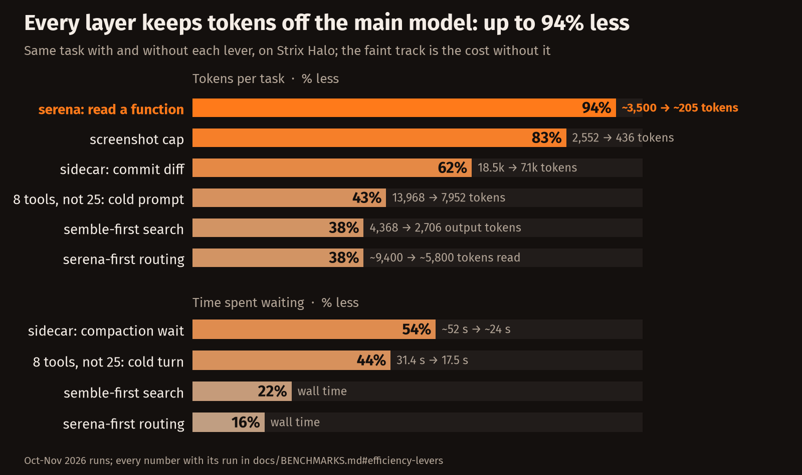

# Local AI Harness for Coding Agents

**Install, update and switch local LLM engines and models.**

Run a coding agent on a local model on your own hardware. Built on [pi](https://github.com/earendil-works/pi), for Linux and
Windows (beta), tuned and measured on AMD Strix Halo.

- **Install:** detects your hardware, recommends an engine and model, then installs, starts and tunes it.
- **Update:** checks for new engine releases; halogen, Strata, gufo and osmos upgrade from the menu and roll back if
  the new version fails its checks.
- **Switch:** halogen, gufo, Strata, osmos, strix-llama.cpp, plain llama.cpp, vLLM, Ollama, LM Studio or a cloud model;
  stock or abliterated weights for Qwen3.8 Flash-Next, Qwen3.8-27B and DeepSeek-V4.1-Flash. One menu, limits re-sized
  on every switch.
- **Plus:** fewer tokens per turn ([efficiency](#efficiency)), crash recovery ([how](docs/SETUP.md#crash-recovery)) and
  NPU side jobs on Strix Halo.

<div align="center">

[](https://github.com/aic0d3r/local-ai-harness/releases/latest)
[](#what-setup-picks-for-you)
[](docs/ENGINES.md#cloud-models-are-a-supported-hybrid)
[](LICENSE)

[Install](#install) •
[Daily use](#daily-use) •
[What setup picks](#what-setup-picks-for-you) •
[Efficiency](#efficiency) •
[Docs](#documentation)

</div>


## Why not just Ollama or LM Studio?

Ollama and LM Studio each run models in their own engine. This harness installs and upgrades the engines tuned for your
hardware (halogen, Strata, gufo, osmos, strix-llama.cpp), switches between them and any Ollama, LM Studio, vLLM or
llama.cpp you already run, and re-sizes the coding agent's limits for each engine and model. Keep Ollama: it is one of
the engines you can switch to.

## Install

Needs [pi](https://pi.dev) (`curl -fsSL https://pi.dev/install.sh | sh`) and [uv](https://docs.astral.sh/uv) for search.
Optional, for the symbol tools: `uv tool install -p 3.13 serena-agent`.

```sh
git clone https://github.com/aic0d3r/local-ai-harness && cd local-ai-harness
./harness setup             # detects your hardware, asks for a model, installs and starts its engine
./start.sh ~/my-project     # opens the coding agent on your project
```

Setup and `./harness config` are interactive menus (arrow keys, Esc goes back), so there are no flags to remember.
Setup asks every question first and installs nothing until you confirm. It installs and starts halogen, gufo, Strata,
osmos and strix-llama.cpp itself; start any other engine (Ollama, vLLM, LM Studio, llama.cpp) before running setup.
`./setup.sh --doctor` checks the whole install, including a live model ping. Flags for scripting and the full walkthrough:
[docs/SETUP.md](docs/SETUP.md).

### Windows (beta)

Verified on a clean Windows 11 VM against a stub engine, not yet on real hardware. In PowerShell:

```powershell
# 1. Install and start Strata: https://github.com/Niko1221/Strata
irm https://pi.dev/install.ps1 | iex   # 2. install pi
git clone https://github.com/aic0d3r/local-ai-harness; cd local-ai-harness
powershell -ExecutionPolicy Bypass -File .\setup.ps1   # 3. offers Git and Python through winget, then uv and Serena
```

`setup.ps1` wires pi to the running Strata; it never installs or starts an engine. Details:
[docs/WINDOWS.md](docs/WINDOWS.md).

## Daily use

```sh
./start.sh ~/my-project     # start the engine if it is down, open pi (add -c to resume the last session)
./harness config            # menu: switch engine, model or weights; upgrade the engine; sidecar; stop an engine
./harness update-check      # newer engine release? upgrade it from ./harness config (rolls back on failure)
./harness status            # what pi is pointed at
./harness tune              # re-measure speed and re-size the limits
./harness monitor           # live prefill/decode speed
```

All commands and uninstall: [docs/SETUP.md](docs/SETUP.md).

**Private by default:** no API key; the weights and your code stay on this machine. Only these reach the internet: web
search, a daily `git fetch` for harness updates (`HARNESS_NO_UPDATE_CHECK=1` turns it off), the engine release check if
you enable it, and downloads you confirm. Cloud models work as a [hybrid](docs/ENGINES.md#cloud-models-are-a-supported-hybrid).

## What setup picks for you

Setup recommends an engine for your hardware. Only Strix Halo is measured here. Off halogen you lose the NPU tools
([list](docs/ENGINES.md#what-breaks-on-another-engine)).

| your hardware | engine | why |
|---|---|---|
| **Strix Halo** (Ryzen AI Max, 128 GB unified) | **halogen** | Flash-Next 125B, fastest measured, plus the NPU tools (guard, triage, dedup) |
| Strix Halo, open source | gufo or Strata | Strata decodes faster, gufo prefills faster |
| Strix Halo, another model | picked per model | Qwen3.6-35B-A3B on **strix-llama.cpp** (85 t/s decode), Qwen3.8-27B on **gufo**, DeepSeek-V4.1-Flash (~768B) on **osmos** at 1M context from one box, Inkling 2 Mini on osmos or Strata |
| **NVIDIA RTX 20-50 / AMD RX 7000-9000, 12 GB+ VRAM** | **[Strata](docs/ENGINES.md#strata-the-pick-for-nvidia-and-amd-desktop-gpus)** | built for it; not measured here. Flash-Next ISTA pack, or [Qwen3.6-35B-A3B](docs/ENGINES.md#other-models-on-strata-and-gufo) from 32 GB |
| Apple Silicon, anything else | Strata natively (`./setup.sh --strata <url>`), llama.cpp, MLX, Ollama or LM Studio | not measured here; the launchers are Linux only |

Speeds: [BENCHMARKS.md](docs/BENCHMARKS.md#engines-on-strix-halo) and [ENGINES.md](docs/ENGINES.md).

## Efficiency

Every layer keeps tokens off the main model: faster prefill locally, a smaller bill on cloud.



- **Symbol tools (94% fewer tokens):** serena reads one function in ~205 tokens instead of ~3,500 for the whole file.
- **Screenshot cap (83%):** a phone screenshot costs 436 tokens on halogen instead of 2,552.
- **Sidecar for commits and compaction:** commit diffs 18.5k to 7.1k tokens (62%); compaction runs in the background,
  ~24 s instead of a ~52 s wait (54%).
- **Small, stable prompt:** 8 tools declared instead of 25, and nothing rewrites the system prompt mid-session. A cold
  turn on osmos: 13,968 to 7,952 tokens (43%), 31.4 s to 17.5 s (44%).
- **Search routing:** semble first for finding code (38% fewer output tokens, 22% less time), serena for a known
  symbol (38% fewer tokens read, 16% less time).
- Also: `rtk` output compression, `tool-trim`, `image-prune`, a warm prompt cache, a prompt-injection gate.

Each lever was measured as the same task with and without it, on an ASUS ROG Flow Z13 (Ryzen AI Max+ 395, 128 GB) at
70 W: the screenshot cap on halogen, the prompt and routing levers on osmos. Every run:
[BENCHMARKS.md](docs/BENCHMARKS.md#efficiency-levers); the stack: [STRIX-HALO.md](docs/STRIX-HALO.md); extensions:
[extensions/README.md](extensions/README.md).

## Documentation

- **[SETUP.md](docs/SETUP.md):** the wizard, flags, all commands, crash recovery, uninstall.
- **[ENGINES.md](docs/ENGINES.md):** engines, models, weights, what breaks off halogen, cloud hybrid.
- **[STRIX-HALO.md](docs/STRIX-HALO.md):** the halogen stack, model files, NPU, upgrading.
- **[BENCHMARKS.md](docs/BENCHMARKS.md)** and **[local vs cloud](docs/local-vs-cloud-model-comparison.md):** measured
  numbers; eight runs on one real debugging task.
- **[LLAMACPP.md](docs/LLAMACPP.md)**, **[OPS.md](docs/OPS.md)**, **[WINDOWS.md](docs/WINDOWS.md):** llama.cpp,
  context size and troubleshooting, Windows.
- **[extensions/README.md](extensions/README.md)** and **[CHANGELOG.md](CHANGELOG.md).**

## Contributing

Only Strix Halo is measured so far. Running `./harness bench` on other hardware (NVIDIA, AMD desktop, Apple) and posting
the result in [Discussions](https://github.com/aic0d3r/local-ai-harness/discussions) turns a "not measured here" into a
number. Bug reports and pull requests: [CONTRIBUTING.md](CONTRIBUTING.md).

If the harness saved you time, a star helps others running local models find it.

## License

[MIT](LICENSE)
