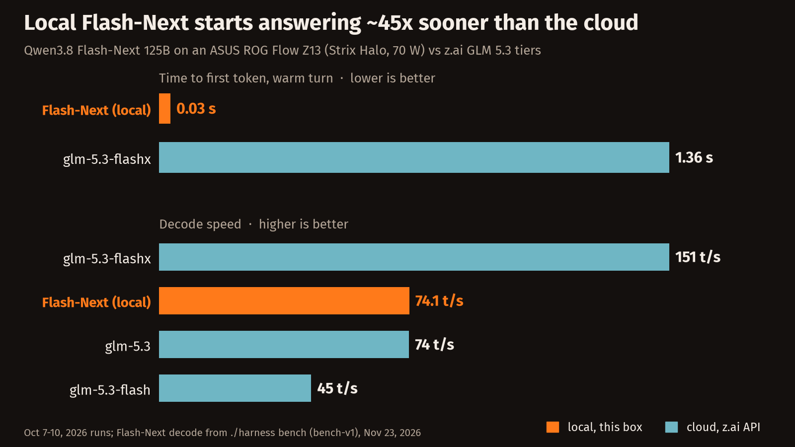

# Local AI Harness for Coding Agents

**Install, update and switch local LLM engines and models.**

Run a coding agent on a local model, on any hardware. Built on [pi](https://github.com/earendil-works/pi), for Linux and
Windows (beta), tuned and measured on AMD Strix Halo.

- **Picks the engine and model for your hardware**, installs and starts it, and sizes limits to your context window.
- **Switches engines:** halogen, gufo, Strata, osmos, strix-llama.cpp, plain llama.cpp, vLLM, Ollama, LM Studio, or a
  cloud model.
- **Stock or abliterated weights** for Qwen3.8 Flash-Next, Qwen3.8-27B and DeepSeek-V4.1-Flash, one menu toggle away.
- **Safe engine upgrades** that roll back if the new version fails its checks.
- **Cuts tokens:** a small prompt, compressed command output, symbol-level code tools, search by meaning.
- **Resumes after a crash:** relaunch and say "continue" ([how](docs/SETUP.md#crash-recovery)).

<div align="center">

[](https://github.com/aic0d3r/local-ai-harness/releases/latest)
[](#which-engine)
[](docs/ENGINES.md#cloud-models-are-a-supported-hybrid)
[](LICENSE)

[Install](#install) •
[Daily use](#daily-use) •
[Which engine](#which-engine) •
[Efficiency](#efficiency) •
[Docs](#documentation)

</div>


## Install

Needs [pi](https://pi.dev) (`curl -fsSL https://pi.dev/install.sh | sh`) and [uv](https://docs.astral.sh/uv) for search.
Optional, for the symbol tools: `uv tool install -p 3.13 serena-agent`.

```sh
git clone https://github.com/aic0d3r/local-ai-harness && cd local-ai-harness
./harness setup             # detects your hardware, asks for a model, installs and starts its engine
./start.sh ~/my-project     # opens the coding agent on your project
```

Setup and `./harness config` are interactive menus (arrow keys, Esc goes back), so there are no flags to remember.
Setup asks every question first and installs nothing until you confirm. It installs and starts halogen, gufo, Strata,
osmos and strix-llama.cpp itself; start any other engine (Ollama, vLLM, LM Studio, llama.cpp) before running it.
`./setup.sh --doctor` checks the install with a live model ping. Flags and the full walkthrough:
[docs/SETUP.md](docs/SETUP.md).

### Windows (beta)

Verified on a clean Windows 11 VM against a stub engine, not yet on real hardware. In PowerShell:

```powershell
# 1. Install and start Strata: https://github.com/Niko1221/Strata
irm https://pi.dev/install.ps1 | iex   # 2. install pi
git clone https://github.com/aic0d3r/local-ai-harness; cd local-ai-harness
powershell -ExecutionPolicy Bypass -File .\setup.ps1   # 3. offers Git and Python through winget, then uv and Serena
```

`setup.ps1` wires pi to the running Strata; it never installs or starts an engine. Details:
[docs/WINDOWS.md](docs/WINDOWS.md).

## Daily use

```sh
./harness config            # menu: switch engine, model or weights; sidecar, update check; stop a running engine
./start.sh ~/my-project     # start the engine if it is down, open pi (add -c to resume the last session)
./harness status            # what pi is pointed at
./harness tune              # re-measure speed and re-size the limits
./harness monitor           # live prefill/decode speed
```

All commands and uninstall: [docs/SETUP.md](docs/SETUP.md).

**Private by default:** no API key; the weights and your code stay on this machine. Only these reach the internet: web
search, a daily `git fetch` for harness updates (`HARNESS_NO_UPDATE_CHECK=1` turns it off), the engine release check if
you enable it, and downloads you confirm. Cloud models work as a [hybrid](docs/ENGINES.md#cloud-models-are-a-supported-hybrid).

## Which engine

Setup recommends an engine for your hardware. Only Strix Halo is measured here. Off halogen you lose the NPU tools
([list](docs/ENGINES.md#what-breaks-on-another-engine)).

| your hardware | engine | why |
|---|---|---|
| **Strix Halo** (Ryzen AI Max, 128 GB unified) | **halogen** | Flash-Next 125B, fastest measured, plus the NPU tools (guard, triage, dedup) |
| Strix Halo, open source | gufo or Strata | Strata decodes faster, gufo prefills faster |
| Strix Halo, another model | picked per model | Qwen3.6-35B-A3B on **strix-llama.cpp** (85 t/s decode), Qwen3.8-27B on **gufo**, DeepSeek-V4.1-Flash (~768B) on **osmos** at 1M context from one box, Inkling 2 Mini on osmos or Strata |
| **NVIDIA RTX 20-50 / AMD RX 7000-9000, 12 GB+ VRAM** | **[Strata](docs/ENGINES.md#strata-the-pick-for-nvidia-and-amd-desktop-gpus)** | built for it; not measured here. Flash-Next ISTA pack, or [Qwen3.6-35B-A3B](docs/ENGINES.md#other-models-on-strata-and-gufo) from 32 GB |
| Apple Silicon, anything else | Strata natively (`./setup.sh --strata <url>`), llama.cpp, MLX, Ollama or LM Studio | not measured here; the launchers are Linux only |

Speeds: [BENCHMARKS.md](docs/BENCHMARKS.md#engines-on-strix-halo) and [ENGINES.md](docs/ENGINES.md).

## Efficiency

Every layer keeps tokens off the main model: faster prefill locally, a smaller bill on cloud.

- **Small, stable prompt:** 8 tools declared instead of 25, nothing rewrites the system prompt mid-session. A cold
  turn on osmos: 13,968 to 7,952 tokens, 31.4 s to 17.5 s.
- **Search routing:** semble first for finding code (-22% wall time, -38% output tokens), serena for a known symbol
  (-16% wall time, -38% tool output).
- **Symbol tools:** a function body in 822 chars instead of 13,980 for the whole file.
- **Sidecar for commits and compaction:** commit diffs 18.5k to 7.1k tokens; compaction ~24 s in the background vs ~52 s.
- **Screenshots:** a phone screenshot from ~1,500 to ~600 tokens.
- Also: `rtk` output compression, `tool-trim`, `image-prune`, a warm prompt cache, a prompt-injection gate.

How each was measured: [BENCHMARKS.md](docs/BENCHMARKS.md#efficiency-levers). Extensions:
[extensions/README.md](extensions/README.md).

## Evidence



ASUS ROG Flow Z13 (Ryzen AI Max+ 395, 128 GB) at 70 W: Flash-Next 125B on the iGPU at 262k context, NPU models
screening prompts, a ling-tiny sidecar for commits and summaries. The stack: [STRIX-HALO.md](docs/STRIX-HALO.md); every
number with its logged run: [BENCHMARKS.md](docs/BENCHMARKS.md).

## Documentation

- **[SETUP.md](docs/SETUP.md):** the wizard, flags, all commands, crash recovery, uninstall.
- **[ENGINES.md](docs/ENGINES.md):** engines, models, weights, what breaks off halogen, cloud hybrid.
- **[STRIX-HALO.md](docs/STRIX-HALO.md):** the halogen stack, model files, NPU, upgrading.
- **[BENCHMARKS.md](docs/BENCHMARKS.md)** and **[local vs cloud](docs/local-vs-cloud-model-comparison.md):** measured
  numbers; eight runs on one real debugging task.
- **[LLAMACPP.md](docs/LLAMACPP.md)**, **[OPS.md](docs/OPS.md)**, **[WINDOWS.md](docs/WINDOWS.md):** llama.cpp,
  context size and troubleshooting, Windows.
- **[extensions/README.md](extensions/README.md)** and **[CHANGELOG.md](CHANGELOG.md).**

## License

[MIT](LICENSE)
