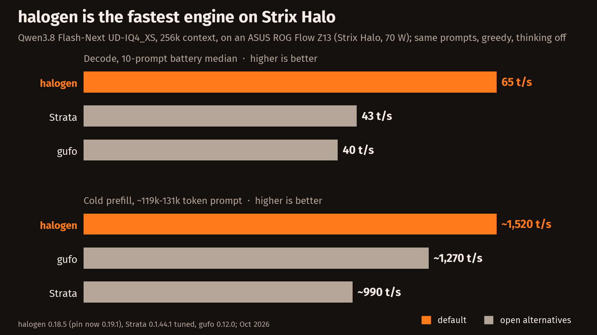
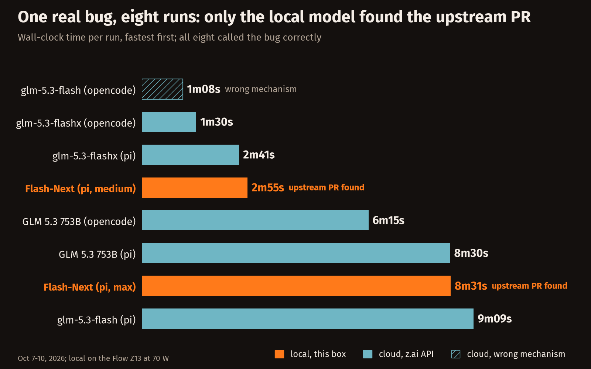
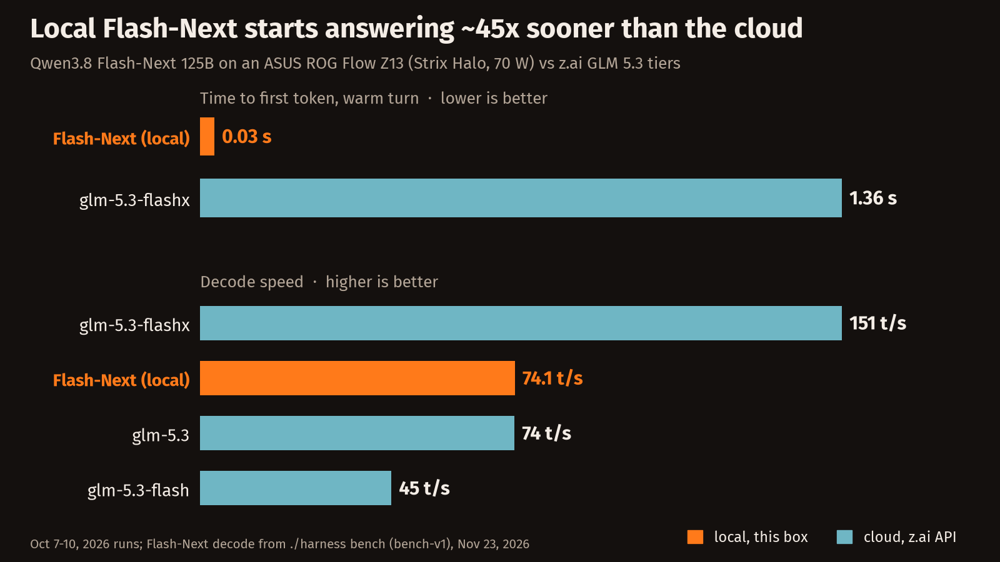
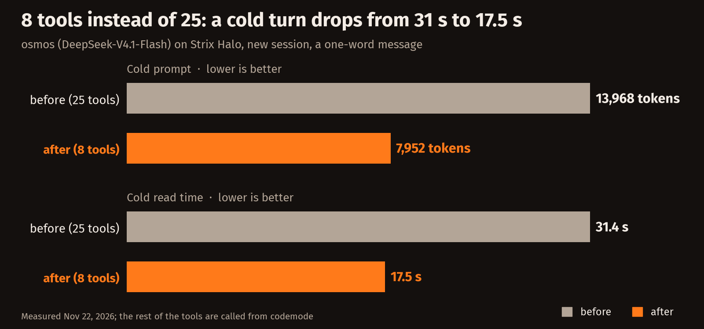

# Benchmark numbers, methodology & what was removed after testing

Rig: ASUS ROG Flow Z13 (Ryzen AI Max+ 395, Radeon 8060S, 128 GB unified, Linux), benches at 70 W sustained. NPU driver needs IOMMU on. NPU numbers below are halogen 0.17.1 (the image pin has since moved to 0.19.1, and 0.18.0 refreshed the NPU device files); ling3.0-tiny sidecar on a strix-halo-llamacpp v0.7.6.1 build.

**NPU microbench (0.17.1, four models resident):**

- Single-query embed: 70ms (ships as `dedup_scan`); rerank: 130ms (idle since v1.1: it belonged to the retired NPU search); guard: 70-130ms (ships as `auto-guard`)
- (On 0.16.2 every NPU call carried ~4s of fixed overhead; 0.16.3's batching fix removed it. If you're on an older release, your NPU numbers are 30x worse than they should be.)
- Decider (binary): 118ms, 78% accuracy (18 realistic prompts); ships as the `triage` tool
- Decider (3-option, free-form output): 925ms, 40% accuracy (too biased toward "keep"). The shipped `triage` constrains the answer with a `json_schema` enum + logprobs instead; multi-option accuracy has not been re-measured since, so treat its output as a hint.
- Moderation: 42% recall / 0% fp on a 30-prompt canary (ships as `auto-guard`)
- Text gen (qwen3.5-2b): 16.6 tok/s decode (removed - slower than the sidecar)
- LLM decode while NPU works: unchanged (separate silicon)

**Capability eval (20 intent queries, 2 repos, 383k tokens indexed, src-only), the old NPU retrieval pipeline, superseded by semble:**

- NPU semantic (src-only index): 15/20 top-3 correct file
- Ripgrep keyword baseline: 9/20 top-3
- Grep latency: ~2-33s per query

**Near-duplicate scan:** 38 files across 4 repo copies, embedded in 8.4s; found 45 pairs with cosine > 0.90; caught every known duplicate plus a renamed file at 1.000 cosine.

**Keyword-poor task (implement --fail-fast in a smoke script):**

- NPU arm: 6.2 / 11.9 / 9.7 / 26.6 min (mean 13.6, all 4 completed)
- Baseline arm: 24.8 / 16.6 / 14.8 min + 1 failed (25% failure rate)
- Saving: 5.1 min per task, with the caveat that the slowest NPU run barely used the tool

**The invalid experiment I almost published:** my first "controlled experiment" showed a 2x speedup, but the NPU arm never had a working index (path bug), and the task was a public httpx fix the model had memorized (92s, zero search calls). Per-call telemetry caught it, and every tool call now logs its index and query.

## Engines on Strix Halo

Matched measurements on this box (halogen and gufo A/B in one session, fabric clock held; Strata re-run 2026-10-14 with
the same `halogen-cmp.py` battery and depth prompts, greedy, thinking off, nonce-tagged so nothing is cached;
UD-IQ4_XS, 256k ctx):

| | halogen 0.19.1 (default; measured on 0.18.5) | Strata 0.1.44.1 (tuned) | gufo 0.12.0 |
|---|---|---|---|
| decode, 10-prompt battery (median) | **65 t/s** | 43 t/s | 40 t/s |
| decode, 2k to 119k context | **47-50 t/s** | 32-36 t/s | 29-32 t/s |
| cold prefill | **~1,520 t/s** (131k in 86 s; 119k in 78 s) | ~990 t/s (119k in 120 s) | ~1,270 t/s (119k in 94 s) |
| `setup.sh` probe, decode (256k ctx, short prompt) | **56 t/s** | 49 t/s | not probed at 256k |
| `setup.sh` probe, cold prefill (256k ctx, ~32k prompt) | ~1,930 t/s | ~1,120 t/s | not probed at 256k |
| warm cache replay | 0.01-0.05 s | 0.4-0.9 s (earlier session) | ~0.1 s |
| NPU tools (guard, triage, dedup) | yes | no | no |
| license | closed | open | **MIT** |

halogen stays the default on Strix Halo (fastest, NPU tools). Strata and gufo are the open alternatives; on this chip
Strata is not the upgrade, because its pitch is NVIDIA/AMD desktop GPUs. To run gufo, stop halogen first (they share one
memory heap), then `server/start-gufo-flashnext.sh` (UD-Q4_K_XL + MTP, `:8080`) and `./setup.sh --gufo` to wire pi to
it. Full numbers: [ENGINES.md](ENGINES.md#what-breaks-on-another-engine).

**Abliterated weights on Strata** (2026-11-08, Strata 0.2.12, the Orca `orca-uncensored/` shards: UD-Q4_K_XL layout, not
IQ4, so slower than the table above, as abliterated GGUFs are on halogen too). 128k ctx, thinking off, one run each, GPU
at full power (85 W median); not the `halogen-cmp.py` battery, so compare within this table only:

| Strata config | prompt, 8k / 30k | decode, 400-token answers | `setup.sh` probe | agent turn (926 tok on 12k cached) |
|---|---|---|---|---|
| what Strata's setup writes (RAM-budget mode), at a 40 W cap | 350-425 t/s | 26-31 t/s | 425 / 31.6 t/s | n/a |
| **after `scripts/strata-uma.py`** (every expert in the GPU pool; runs on each start) | **1,081 / 1,082 t/s** | **47.5-47.7 t/s** | **1,034 / 42.2 t/s** | **1.12 s** |
| plus the rest of Strata's fast config (`PF_F16`, `--lookup-chain 3`, `--mtp-q4 all`, ...) | 1,030 / 1,044 t/s | 46.7-47.4 t/s | 1,007 / 43.1 t/s | 1.16 s |

For scale, Strata's own Linux Strix Halo numbers for the stock UD-Q4_K_XL file are 1,169-1,248 t/s prompt and 43-53 t/s
decode. The first row was measured at a 40 W cap, so it overstates the gain. Details:
[ENGINES.md](ENGINES.md#strata-the-pick-for-nvidia-and-amd-desktop-gpus).

**Qwen3.6-35B-A3B UD-Q4_K_XL: which engine (2026-11-16).** Same protocol as `./harness tune` (`bench-v1`: warm-up,
3 x 256-token greedy code answers, one 8K cold prefill), one engine at a time, the whole 124 GiB pool, 131072 ctx:

| engine | decode (short code) | prefill, 8K | note |
|---|---|---|---|
| **llama-server (halo-box image, Vulkan) + MTP-2** | **85.3 t/s** | **2,048 t/s** | the engine `./harness use llamacpp` starts (85-88% of drafts accepted) |
| llama-server (Vulkan, `-fa on -ub 1024`) | 59.8 t/s | 1,017 t/s | no draft layer; `-b 4096 -ub 1024 -fa on` |
| llama-server (Vulkan, defaults) | 60.0 t/s | 933 t/s | `-b 2048 -ub 512` |
| Strata image 0.2.13, `PARALLEL=1` (prompt chunk 4096) | 51.7-52.6 t/s | 601-692 t/s | every routed expert in VRAM (18.75 GiB); the launcher's default now |
| Strata image 0.2.13, default (4 slots, chunk 1024) | 49.3 t/s | 479 t/s | what a bare `docker run` gives |
| gufo 0.32.0 | - | - | refuses the file: "No text provider found for model architecture" (qwen35moe is not in its runtime) |

Strata loads the MTP block but proposes no drafts on this file, so its decode gets no speculative gain: `drafts accepted 0 of
0` for every request, including the engine's own warm-up, at temperature 0 / 0.7 / 1.0, with `--mtp 1` and `--mtp 2`,
with `--spec 4`, with `STRATA_SPEC_COUPLED=1` and with `--mtp-hnorm stream` (the file carries the whole block:
`blk.40.nextn.{eh_proj,enorm,hnorm,shared_head_norm}.weight`). Strata's own notes on this exact box (Ryzen AI Max+ 395,
UD-Q4_K_XL) report 52.8-59.9% draft acceptance and 41-45 t/s output, so the zero acceptance is a defect or mismatch here,
not the hardware. The parallel count decides its MoE prompt chunk: `--parallel 4` caps it at 1024, one slot gets 4096
(8192 with 131k ctx is refused: "bad --chunk / --max-context"), and the chunk is worth +44% prefill here.

llama.cpp drafts with the model's own MTP head (the top row); a separate draft model would need a smaller sibling of the
same vocabulary, which Qwen3.6 does not have (smallest: 27B). The ROCm image (`LLAMACPP_BACKEND=rocm`) measured slower
here ([LLAMACPP.md](LLAMACPP.md)), so it is not in the table.

## Efficiency levers

The harness is tuned to spend as few tokens, and as little main-model time, as possible:

| lever | what it does | measured |
|---|---|---|
| **rtk** (`pi-rtk-optimizer`) | rewrites bash commands through the `rtk` binary so test, build and git output arrives compressed | per-command savings in `rtk gain`; no aggregate benchmark in this repo yet |
| **`tool-trim`** | strips ANSI/progress noise, caps huge output (full text saved to a file), identical re-reads of unchanged files become a pointer; a whole-file read of a big source file gets a one-line hint to use serena or `offset`/`limit` | token savings shown by `/usage` |
| **`image-prune`** | a screenshot the agent read stays in every later request until a provider refuses it (30 on DeepInfra) and keeps costing prefill; only the newest 4 images go out, older or duplicate ones become a re-read hint. Session files keep every image. `setup.sh` also caps image resolution on every image-capable model at 450×1000 (`scripts/set-image-limits.py`, `PI_IMAGE_MAX=WxH` or `off`): a 1080×2400 phone screenshot drops from 2,552 to 436 prompt tokens on halogen 0.21.0 (-83%, measured 2026-11-25: same image full vs capped, `max_tokens` 1, text-only baseline subtracted), ~1,500 to ~600 on Claude | logged to `harness-events.jsonl` (`c: "image-prune"`) |
| **serena** (LSP symbol tools) | reads one function or an outline instead of the whole file; precise symbol edits and renames | 822 chars for a function body vs 13,980 to read the file; 390 for an outline; callers cost more than grep ([details](#serena-context-returned-per-navigation-task-2026-10-16)) |
| **semble search** | finds code by meaning instead of reading files to explore | 17/18 vs 13/18 top-3 hits, 2-3x faster queries, ~40x faster indexing than the NPU pipeline it replaced |
| **Sidecar + NPU** | commits, compaction and repo maps run off the main model; screening and routing on the NPU | compaction ~24 s non-blocking vs ~52 s blocking; large commit diffs 18.5k to 7.1k tokens (2.5x faster) |
| **Warm prompt cache** | diffs and transcripts never touch the main model's prefix | warm replay 0.01-0.05 s on halogen |
| **Small, stable prompt prefix** | only read/bash/edit/write, codemode, ask_user_question (short guidance) and ddg are declared; serena, semble, subagent, triage and dedup_scan are called from codemode; no extension rewrites the system prompt mid-session | cold prompt 13,968 to 7,952 tokens, 31.4 to 17.5 s on osmos; a progress note no longer costs a ~30 s cache miss ([details](#prompt-prefix-and-tool-routing-2026-11-22)) |
| **Search and symbol routing** (`APPEND_SYSTEM.md`) | semble first to find code; serena once the task is about a known symbol | semble: -22% wall time, -38% output tokens, 6/6 vs 5/6 correct; serena line: -16% wall time, -38% tool output read ([details](#prompt-prefix-and-tool-routing-2026-11-22)) |

For device or browser testing, prefer text over pixels: `adb shell uiautomator dump` or an accessibility snapshot costs a
few hundred tokens. When a screenshot is needed, crop to the area that matters
(`adb exec-out screencap -p | magick - -crop 1080x800+0+400 /tmp/s.png`).

On a cloud model the same levers cut input tokens directly, which is where the API savings come from; locally they cut
prefill time.

## Local vs cloud charts

Measured on an ASUS ROG Flow Z13 (Ryzen AI Max+ 395, Radeon 8060S, 128 GB) at 70 W sustained.

## Serena: context returned per navigation task (2026-10-16)

One call each on this repo (`setup/harness.py`, 13,980 chars), characters returned to the model
(~4 chars per token). The "grep" arm is a careful baseline (`grep -n` plus a few lines of context);
"read" is the naive one.

| task | serena | grep + context | read the file |
|---|---|---|---|
| body of one function (`finish`) | 822 | 1,186 | 13,980 |
| outline of a file | 390 | 761 | 13,980 |
| callers of a function | 813 | 313 | n/a |

Serena is ~17-36x smaller than reading the file and 1.4-2x smaller than careful grep, but **larger**
than grep for callers (it adds the containing symbol). Limits seen: only the Python language server was
active in this project then, so `get_symbols_overview` on a `.ts` file errored.

Real usage across 416 logged sessions (`~/.pi/agent/sessions`): `read` returned a median 2,605 and
mean 7,029 chars over 1,246 calls; serena navigation returned a mean 213-244 chars
(`find_symbol`, `get_symbols_overview`) but ran only ~35 times, in 29 sessions. The saving exists;
the agent rarely takes it.

## Prompt prefix and tool routing (2026-11-22)

osmos (DeepSeek-V4.1-Flash, `osmos-evo`), thinking off, Strix Halo. osmos reuses its cache only while the
prompt's leading tokens are identical, and prefills at ~440 tok/s, so every token in the system prompt and the
tool list is ~2.3 ms of wait on each cold turn (new session, or anything that changes the prefix).

**Where the time went.** In plain chat sessions every turn logged `0 reused (none)` and took ~31 s. Causes:

| cause | effect | fix |
|---|---|---|
| `progress-tracker` returned its resume note as a replacement `systemPrompt` | that turn's prefix differed: full re-read, and other sections dropped for the turn | checkpoint only: nothing injected (`pi -c` resumes the whole conversation) |
| thinking level changed mid-session | osmos writes `Reasoning Effort: N` at the top of the prompt | none: pick the level at session start |
| 25 tools declared (~8k tokens) | read again on every cold turn | 8 declared, the rest via codemode |

**The prefix, before and after** (same session start, a 1-word message):

| | tools declared | cold prompt | cold read |
|---|---|---|---|
| before | 25 | 13,968 tokens | 31.4 s |
| after | 8 | 7,952 tokens | 17.5 s |
| a turn after the progress note, before / after the fix | | 0 / 13,967 reused | 32.4 / 9.4 s |

`ask_user_question` was kept with trimmed guidance (`config/ask-user-question.json`): ~2.7k chars of prompt instead of ~5.5k.

**Semble first** (6 "where is X" questions on this repo, one fresh session each, order alternated; the rule
in `APPEND_SYSTEM.md`):

| | rg (default habit) | semble first |
|---|---|---|
| wall time | 472 s | **367 s** (-22%) |
| model turns | 33 | **22** |
| output tokens | 4,368 | **2,706** (-38%) |
| correct | 5/6 | **6/6** |

Most of the gap is one question rg answered wrong after 13 calls; without it semble is ~6% faster and uses ~22%
fewer output tokens. The same rule placed in `AGENTS.md` was ignored (0 semble calls, 229 s, wrong answer); at the
end of the system prompt (`APPEND_SYSTEM.md`) it was followed.

**Serena for known symbols** (6 symbol questions: callers, a function body, an outline; Python/TypeScript only):

| | without the serena line | with it |
|---|---|---|
| wall time | 296 s | **247 s** (-16%) |
| tool-result text read | 37,450 chars | **23,260** (-38%) |
| output tokens | 2,936 | **2,311** (-21%) |
| correct | 5/6 | 5/6 |

The gain came from narrower reads more than from serena calls (one per arm), so the rule is scoped: serena once the
task names a symbol, not for search, docs, config, shell or languages without a language server.

Limits: one run per question per arm, one model (osmos); not repeated on halogen or cloud models.

## Install & ops

**Install: fully automated, one prompt total.** Clone github.com/aic0d3r/local-ai-harness (tagged releases, MIT, changelog in the repo) and run `./setup.sh --halogen auto` (Strix Halo; for other hardware or cloud models see [Engines](ENGINES.md)). It installs pi via npm if missing, pulls the pinned halogen image, and if you don't have the model files it downloads them for you: ~124 GB resumable (that's the one prompt you'll see; it checks your free space first), then the pinned strix-llama.cpp image for the sidecar, the tiny GGUF sha256-verified against Hugging Face, the extension suite, prompt templates, theme, and the systemd keep-alive unit. Your own model entries and pi settings are never touched. `./setup.sh --doctor` verifies every piece with live probes; `./setup.sh --uninstall` backs everything up and returns pi to stock in one command.

**Docker is the one prerequisite** we won't auto-install (system package, needs sudo). First boot pins the 47.7 GiB lookup table from disk, so a few minutes of startup is normal. The launcher pre-flights allocator fragmentation before committing to 262k context and, if recovery fails, falls back to 65k/2-slot in seconds and prints the exact fix instead of wedging for half an hour, and a 15-min systemd compaction timer keeps the allocator healthy between sessions.

The container image is version-pinned; `scripts/session-audit.sh` runs post-session forensics (cache hit, compaction events, sidecar rejections, NPU index anomalies) and checks the serving version against the pin.
